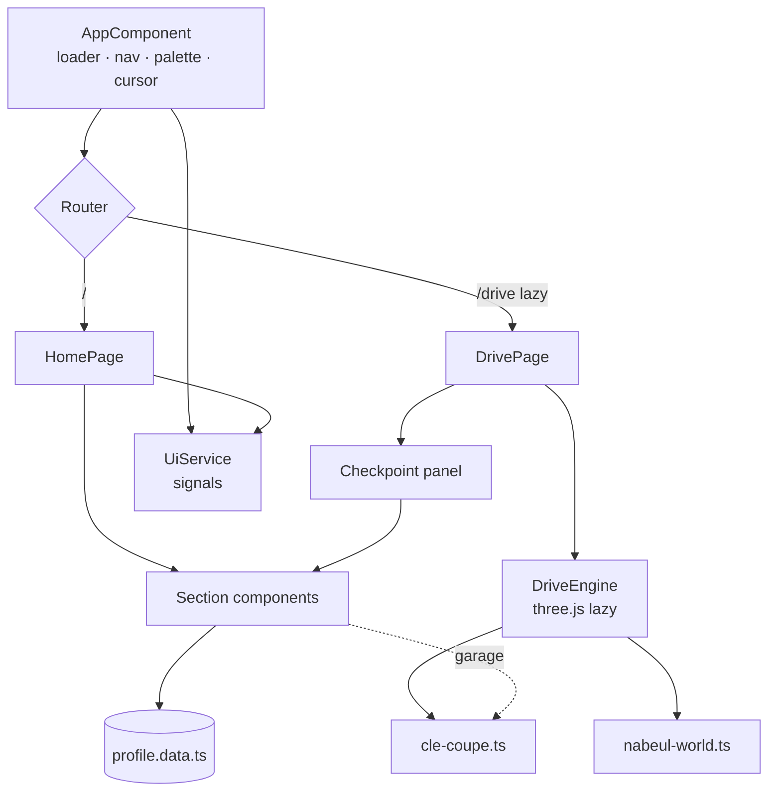

<div align="center">

# TUNÉRA

**The interactive portfolio of Dhia Eddine Saied Full Stack Developer, Nabeul, Tunisia**

Read it as an editorial portfolio, or explore it behind the wheel of a Mercedes-Benz CLE Coupé on a 3D map of Nabeul.


</div>

---

## Table of Contents

1. [Overview](#overview)
2. [Project Objectives](#project-objectives)
3. [Features](#features)
4. [Technologies Used](#technologies-used)
5. [UI/UX Design](#uiux-design)
6. [Project Architecture](#project-architecture)
7. [Installation](#installation)
8. [Getting Started](#getting-started)
9. [Project Structure](#project-structure)
10. [Configuration](#configuration)
11. [Screenshots & Preview](#screenshots--preview)
12. [Video Presentation](#video-presentation)
13. [Performance & Optimization](#performance--optimization)
14. [Responsive Design](#responsive-design)
15. [Security](#security)
16. [Future Improvements](#future-improvements)
17. [Author](#author)
18. [License](#license)

---

## Overview

**TUNÉRA** is a single-page Angular application that presents the professional profile of **Dhia Eddine Saied**, a Full Stack Developer based in Nabeul, Tunisia. It offers two complementary ways to discover the same content:

| Mode | Route | Experience |
| --- | --- | --- |
| **Profile** | `/` | A scrolling, editorial portfolio with animated sections, filters and detail views. |
| **Drive** | `/drive` | A real-time 3D city of Nabeul. Drive a procedurally modelled Mercedes-Benz CLE Coupé to ten checkpoints, each of which opens a portfolio section. |

The visual identity draws on Tunisian heritage limewashed walls, Tunisian blue, Nabeul's ceramic terracotta and the eight-point star motif expressed with solid colours only and a restrained, international aesthetic.

All professional content (summary, experience, education, certifications, skills, languages and featured work) lives in a single typed data file and is drawn from Dhia's LinkedIn profile and his own curriculum vitae.

---

## Project Objectives

- **Present a professional profile with character** go beyond a standard résumé layout while keeping the information accurate and easy to scan.
- **Represent Nabeul as a modern city** urban streets, contemporary architecture, the monumental jar, a minaret, a ceramics souk and the Mediterranean corniche.
- **Offer an exploratory experience** let visitors *explore* the portfolio by driving through it, while keeping a conventional reading mode one click away.
- **Keep the codebase clean and scalable** standalone components, signals, strict TypeScript, and content fully separated from presentation.
- **Stay fast and accessible** a small initial bundle, lazy-loaded 3D, reduced-motion support and keyboard navigation.

---

## Features

### Profile mode (`/`)

| Section | Highlights |
| --- | --- |
| **Intro loader** | Animated *TUNÉRA* wordmark with a progress counter; shortened on repeat visits within a session. |
| **Hero** | Arch-framed portrait with pointer parallax, line-by-line title reveal, animated statistics, rotating seal and a skills marquee. |
| **About** | Professional summary with a sticky profile card (location, role, work mode, education). |
| **Nabeul** | Hand-built SVG skyline with parallax layers minaret, monumental jar, glass tower, palms, corniche, sea and an animated CLE silhouette. |
| **Services** | Six service cards with hover inversion and 3D tilt. |
| **Featured** | Project cards with solid-colour cover artwork and an accessible detail dialog (keyboard navigation with ← → and Esc). |
| **Activity** | Filterable feed of posts and milestones, with a link to the full LinkedIn activity. |
| **Experience** | Accordion timeline with expandable responsibilities and technology tags. |
| **Education** | Diploma cards with acquired skills. |
| **Licenses & Certifications** | Grouped by year, filterable by issuer, with live search. |
| **Skills** | Tabbed categories (frontend, backend, databases, mobile, tools, UI/UX & CMS, practices) and working-style highlights. |
| **Languages** | Five languages with native-script names and proficiency meters. |
| **Garage** | Interactive 3D turntable of the CLE Coupé drag to rotate, choose from five paint finishes. |
| **Contact** | Email, LinkedIn and GitHub links, plus a live clock in Nabeul's time zone. |

### Drive mode (`/drive`)

- Procedurally generated 3D Nabeul: city grid, roundabout with the monumental jar, Great Mosque minaret and dome, ceramics souk, civic plaza with fountain, business district, seafront hotels, palm-lined corniche, beach, sea, jetty and boats.
- Arcade driving model with acceleration, braking, reverse, boost, handbrake, steering and building collisions.
- Chase camera that pulls in and rises to avoid clipping into buildings.
- Ten floating checkpoints; arriving at one prompts **Enter** to open the corresponding section in a side panel (bottom sheet on mobile).
- HUD with mini-map, speedometer, discovery progress and a checkpoint list with **fast travel**.
- On-screen pedals and steering for touch devices.
- Graceful fallback message when WebGL is unavailable.

### Global

- **Command palette** (`Ctrl` / `⌘` + `K`) to jump to any section or action.
- Auto-hiding navigation bar with scroll progress and active-section highlighting.
- Full-screen mobile menu.
- Custom cursor on fine pointers.
- Reveal-on-scroll, magnetic buttons and card tilt, all disabled under `prefers-reduced-motion`.

### Keyboard controls (Drive mode)

| Key | Action |
| --- | --- |
| `W` / `↑` | Accelerate |
| `S` / `↓` | Brake / reverse |
| `A` / `D` / `←` / `→` | Steer |
| `Shift` | Boost |
| `Space` | Handbrake |
| `Enter` | Start driving / open nearby checkpoint |
| `Esc` | Close panel or checkpoint list |

---

## Technologies Used

| Category | Technology | Version | Purpose |
| --- | --- | --- | --- |
| Framework | [Angular](https://angular.dev) | 17.3 | Standalone components, signals, built-in control flow, router |
| Language | TypeScript | 5.4 | Strict typing across the application |
| 3D | [three.js](https://threejs.org) | 0.160 | City, car, lighting, shadows and rendering |
| Reactive | RxJS | 7.8 | Router event streams |
| Styling | SCSS | | Design tokens, global styles, component styles |
| Build | Angular CLI `application` builder (esbuild) | 17.3 | Development server and production builds |
| Testing setup | Karma + Jasmine | 6.4 / 5.1 | Default Angular test runner (no specs written yet) |
| Fonts | Google Fonts Instrument Serif, Manrope, JetBrains Mono | | Display, body and monospaced typography |

**Browser APIs used:** WebGL, Canvas 2D, `IntersectionObserver`, `ResizeObserver`, `requestAnimationFrame`, View Transitions (through the Angular router), `Intl.DateTimeFormat` and `sessionStorage`.

---

## UI/UX Design

### Visual identity

The palette uses **solid colours only no gradients**:

| Token | Hex | Role |
| --- | --- | --- |
| Ink | `#0f1b2d` | Primary dark surface and text |
| Paper | `#f4f0e8` | Limewash background |
| Tunisian Blue | `#1d5ba6` | Openings, accents, Languages section |
| Nabeul Terracotta | `#c0532b` | Ceramic accent, calls to action |
| Sand | `#e3cfa6` | Beach and secondary accents |

Colours are defined as CSS custom properties in `src/styles.scss`. Sections switch between light, dark (`.tone-dark`) and blue (`.tone-blue`) tones by redefining the same contextual tokens.

### Typography

- **Instrument Serif** large display headings
- **Manrope** body and interface text
- **JetBrains Mono** labels, metadata and indices

### Heritage details

- Portrait framed in an **arch**, echoing Tunisian architecture.
- A subtle **eight-point star (khatam)** pattern behind the hero.
- The **monumental jar**, a nod to Nabeul's ceramics tradition, appears in the SVG skyline and the 3D city.
- A bilingual **Nabeul · نابل** welcome sign in Drive mode.

### Iconography

A custom inline-SVG line icon set (`shared/icon.component.ts`) with a 24 px grid and 1.5 px stroke is used throughout. The interface contains no emojis.

### Interaction principles

- One easing curve family for consistent motion.
- Every animated element has a static, readable end state.
- Interactive elements expose focus styles, ARIA roles (`tablist`, `dialog`, `radiogroup`, `meter`, `listbox`) and labels.

---

## Project Architecture



**Key decisions**

- **Content as data.** Every piece of text is stored in `core/data/profile.data.ts` and typed by `core/models/profile.models.ts`. Sections only render it.
- **Reusable sections.** The same section components render on the home page and inside the Drive-mode panel. CSS container queries let them adapt to the width of their container rather than the viewport.
- **Signals for state.** `UiService` holds global UI state (intro, menu, palette, active section) as Angular signals; components use `OnPush` change detection.
- **3D outside Angular.** `DriveEngine` and the garage turntable run their render loops outside the Angular zone and only report meaningful changes (nearby checkpoint, speed, visits) back into it.
- **Instanced rendering.** The city batches thousands of repeated meshes (windows, palms, lamps, road markings) into a few `InstancedMesh` draw calls.

---

## Installation

### Prerequisites

| Tool | Recommended version |
| --- | --- |
| Node.js | 18.13+ or 20.x (developed with 20.20) |
| npm | 9+ (developed with 10.8) |
| Angular CLI | Optional globally the local CLI is used via `npx` / npm scripts |

### Steps

```bash
# 1. Move into the project folder
cd tunera

# 2. Install dependencies
npm install
```

---

## Getting Started

### Development server

```bash
npm start
```

Open <http://localhost:4200>. The application reloads automatically when source files change.

To use another port:

```bash
npx ng serve --port 4300
```

### Production build

```bash
npm run build
```

The optimized output is written to `dist/tunera/browser/`, ready to be served by any static web host.

### Watch build

```bash
npm run watch
```

### Tests

```bash
npm test
```

> The Karma/Jasmine runner is configured, but the project does not contain spec files yet.

> **Hosting note:** Angular routes such as `/drive` are client-side. When deploying, configure the server to fall back to `index.html` for unknown paths.

---

## Project Structure

```text
tunera/
├── angular.json                      # Angular workspace & build configuration
├── package.json                      # Scripts and dependencies
├── tsconfig.json                     # Strict TypeScript configuration
└── src/
    ├── index.html                    # Meta tags, favicon, Google Fonts
    ├── main.ts                       # Application bootstrap
    ├── styles.scss                   # Design tokens, tones, base styles, utilities
    ├── assets/
    │   └── dhia-eddine-saied.jpg     # Profile photograph
    └── app/
        ├── app.component.ts          # Root shell
        ├── app.config.ts             # Router providers (scrolling, view transitions)
        ├── app.routes.ts             # "/" and lazy "/drive" routes
        ├── core/
        │   ├── data/profile.data.ts  # All portfolio content
        │   ├── models/               # Content interfaces
        │   └── services/ui.service.ts
        ├── layout/                   # Nav, loader, command palette, cursor
        ├── pages/
        │   ├── home.page.ts          # Scrolling portfolio
        │   └── drive.page.ts         # 3D experience + HUD + section panel
        ├── sections/                 # Hero, About, Nabeul, Services, Featured, Activity,
        │                             # Experience, Education, Certifications, Skills,
        │                             # Languages, Garage, Contact
        ├── shared/                   # Icon set, section header, motion directives
        └── three/
            ├── cle-coupe.ts          # Procedural Mercedes-Benz CLE Coupé
            ├── nabeul-world.ts       # Procedural city, landmarks and checkpoints
            ├── drive-engine.ts       # Renderer, physics, camera, input, mini-map
            └── paints.ts             # Paint finishes (three.js-free)
```

---

## Configuration

The project has no environment variables or backend. Common customizations:

| What | Where |
| --- | --- |
| Profile content (summary, jobs, education, certifications, skills, languages, projects, activity) | `src/app/core/data/profile.data.ts` |
| Section order and navigation labels | `SECTIONS` in `profile.data.ts`, template in `pages/home.page.ts` |
| Colours, fonts, spacing, radii | CSS custom properties in `src/styles.scss` |
| Profile photograph | `src/assets/dhia-eddine-saied.jpg` (path set in `IDENTITY.photo`) |
| Page title, description and Open Graph tags | `src/index.html` |
| Checkpoint positions and labels | `CHECKPOINTS` in `src/app/three/nabeul-world.ts` |
| Driving feel (top speed, boost, car radius, trigger distance) | Constants at the top of `src/app/three/drive-engine.ts` |
| Car paint finishes | `src/app/three/paints.ts` |
| Bundle size budgets | `budgets` in `angular.json` |

**Example adding a certification:**

```ts
// src/app/core/data/profile.data.ts
export const CERTIFICATIONS: Certification[] = [
  { title: 'New Certification', issuer: 'Issuer', date: 'Nov 2026', year: 2026 },
  // ...
];
```

The certification count, year grouping, issuer filters and hero statistics update automatically.

---

## Screenshots & Preview

No screenshots are included in the repository yet. To add them:

1. Create a folder such as `docs/screenshots/`.
2. Capture the views below on desktop and mobile.
3. Reference them here:

```markdown


```

Suggested views: Hero, Nabeul skyline, Featured dialog, Experience timeline, Garage turntable, Drive-mode intro, driving near a checkpoint, and an open checkpoint panel.

---

## Video Presentation

No video presentation is included yet. A short walkthrough of the profile and a drive through Nabeul's checkpoints would make a good addition. Once recorded, link it here or embed a thumbnail:

```markdown
[](VIDEO_URL)
```

---

## Performance & Optimization

| Technique | Implementation |
| --- | --- |
| **Lazy-loaded 3D** | three.js is excluded from the initial bundle. It loads only when `/drive` is opened or when the Garage section approaches the viewport. |
| **Small initial payload** | The production initial bundle is about **355 kB raw / 97 kB transferred**. The drive page and engine load as separate chunks. |
| **Instancing** | Windows, buildings, palms, lamps and road markings render through `InstancedMesh` batches. |
| **Zone-free render loops** | Animation and scroll listeners run outside `NgZone`; Angular only updates when state actually changes. |
| **OnPush + signals** | Every component uses `ChangeDetectionStrategy.OnPush`. |
| **Paused when hidden** | Render loops skip frames while the tab is hidden; the garage renders only while visible. |
| **Capped pixel ratio** | The renderer limits device pixel ratio (1.5 in Drive mode, 2 in the garage). |
| **Focused shadows** | The sun's shadow camera follows the car, keeping the shadow map small but sharp. |
| **Resource cleanup** | Geometries, materials, textures and renderers are disposed when leaving a page. |
| **Deterministic generation** | Seeded random numbers produce the same city and skyline on every load. |
| **Image priority** | The hero portrait uses `fetchpriority="high"`; other images use `loading="lazy"`. |

---

## Responsive Design

- **Fluid typography and spacing** with `clamp()`.
- **Container queries** each section adapts to its own width, so it works both full-page and inside the Drive-mode panel.
- **Navigation** collapses into a full-screen menu below 1240 px; secondary actions hide on small phones.
- **Hero** stacks the portrait above the text on tablets and phones.
- **Drive mode on mobile:** the HUD is repositioned, the checkpoint panel becomes a bottom sheet, and touch pedals appear on coarse-pointer devices.
- **Mobile-safe units** (`svh`) and `viewport-fit=cover` for modern phones.
- Verified at 1440 px desktop and 390 px mobile widths without horizontal overflow.

---

## Security

TUNÉRA is a static front-end with **no backend, forms, authentication, cookies or user data collection**.

- **No unsafe HTML** all content is rendered through Angular templates with built-in sanitization; `innerHTML` is not used.
- **External links** open with `target="_blank"` and `rel="noopener"`.
- **Minimal client storage** a single `sessionStorage` flag remembers that the intro has played. Access is wrapped in `try/catch`.
- **Contact data** only the email address and public profile links are displayed.
- **Third-party requests** are limited to Google Fonts.
- **Dependencies** run `npm audit` regularly and keep Angular and three.js up to date.

For production hosting, consider adding a Content Security Policy and standard security headers at the server or CDN level.

---

## Future Improvements

- Add unit and end-to-end tests for components, filters and the driving engine.
- Add screenshots and a video presentation to this README.
- Load a dedicated 3D model of the CLE Coupé (glTF with Draco compression) in place of the procedural one.
- Add day/night lighting and ambient engine/city sound with a mute control.
- Add gamepad support and a "guided tour" autopilot across all checkpoints.
- Add French and Arabic translations (with right-to-left layout) using Angular i18n.
- Add a `robots.txt`, sitemap and structured data (JSON-LD `Person`) for SEO.
- Add a light/dark theme toggle that respects the system preference.
- Upgrade to the latest Angular version and enable zoneless change detection.

---

## Author

**Dhia Eddine Saied**
Full Stack Developer · Nabeul, Tunisia

| | |
| --- | --- |
| Email | [Dhiasaied733@gmail.com](mailto:Dhiasaied733@gmail.com) |
| LinkedIn | [linkedin.com/in/saied-dhia](https://www.linkedin.com/in/saied-dhia/) |
| GitHub | [github.com/dhiasaied](https://github.com/dhiasaied) |

---

## License

No license file is included yet, so all rights are reserved by the author by default. To allow reuse, add a `LICENSE` file (for example MIT) at the project root and update this section.

> *Mercedes-Benz* and *CLE* are trademarks of Mercedes-Benz Group AG. The car in this project is an original procedural 3D representation created for this portfolio, and this project is not affiliated with or endorsed by Mercedes-Benz.

---

<div align="center">

Designed and built in Nabeul, Tunisia, with Angular.

</div>
